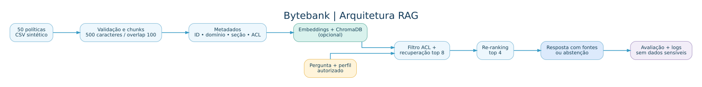
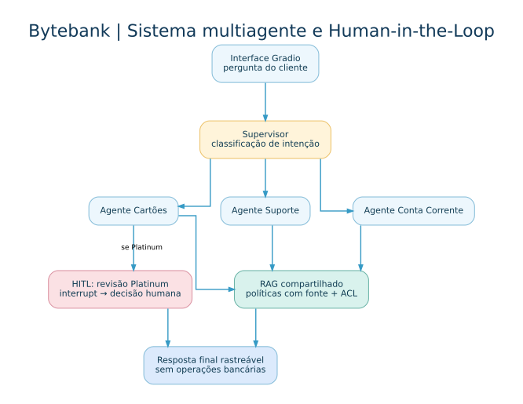

# Bytebank | Ecossistema de IA com RAG e Multiagentes

**Projeto de portfólio · Checkpoint Especialista em IA — Nível 2 (Alura)**

> Projeto educacional e **100% fictício**. O Bytebank, as políticas, as decisões e os fluxos de cartões aqui representados são simulações. Não há acesso a contas, clientes ou serviços bancários reais.

Este projeto demonstra o caminho de uma solução de IA responsável: da **governança** à **recuperação fundamentada de documentos (RAG)**, passando por **avaliação**, **orquestração multiagente**, **protocolos A2A/MCP** e **aprovação humana (Human-in-the-Loop)**.

## Visão geral

| Camada | Entrega | Evidência |
|---|---|---|
| 1 · Governança | Papéis e responsabilidades, ética, LGPD e MLOps | [Governança](docs/01-governanca.md) · [Time em CSV](data/time_ia.csv) |
| 2 · Arquitetura | Pipeline RAG com chunking, metadados, filtros e decisão arquitetural | [Arquitetura](docs/02-arquitetura-rag.md) · [ADR](docs/adr-001-rag.md) |
| 3 · Implementação | Base fictícia de 50 políticas, retriever, re-ranking e avaliação | [Código RAG](src/bytebank/rag.py) · [Avaliação](docs/03-avaliacao.md) |
| 4 · Multiagentes | Supervisor, especialistas, handoff humano, A2A/MCP e interface | [Arquitetura multiagente](docs/04-multiagentes.md) · [Protocolos](docs/05-protocolos.md) |

## Arquitetura RAG



1. Carrega `data/politicas_bytebank.csv` e valida os campos.
2. Fraciona os documentos em chunks de aproximadamente **500 caracteres com overlap de 100**. No modo com LangChain, aplica `RecursiveCharacterTextSplitter`.
3. Enriquece com `id`, `dominio`, `secao`, `nivel_acesso` e `categoria`.
4. Indexa em **ChromaDB + OpenAI Embeddings** quando configurado; para demonstração sem credenciais, utiliza um recuperador lexical local.
5. Recupera até **8** trechos acessíveis ao perfil e reordena os **4** melhores.
6. Gera resposta somente com o contexto recuperado, citando `id` e recusando fundamentação insuficiente.

> **Sem chave de API:** o protótipo roda integralmente em modo **offline**, com respostas extrativas e busca lexical. **Com chave:** habilita geração por LLM e embeddings sem alterar a API da aplicação. O modo offline não deve ser apresentado como equivalente semântico ao RAG vetorial.

## Arquitetura multiagente



- **Supervisor:** classifica a solicitação como `conta_corrente`, `cartao_credito` ou `suporte` e roteia para o especialista.
- **Especialistas:** consultam a mesma política de autorização e usam a recuperação contextual para preparar respostas com fonte.
- **Aprovação Platinum:** pede decisão humana antes de prosseguir em um caso hipotético de solicitação de cartão; **não emite cartão**, **não aprova crédito real** e **não executa transações**.
- **A2A:** contrato de mensagens entre agentes; **MCP:** acesso padronizado a ferramentas e recursos. O repositório documenta exemplos de contratos, sem alegar implementar servidores A2A/MCP completos.

## Rodar localmente (sem chave)

```bash
git clone https://github.com/nathalia-simeao/bytebank-ia-multiagentes.git
cd bytebank-ia-multiagentes
python -m venv .venv
source .venv/bin/activate  # Windows: .venv\\Scripts\\activate
pip install -e .
python scripts/run_demo.py --pergunta "Como faço para abrir uma conta corrente?"
python scripts/run_demo.py --pergunta "Quero solicitar cartão Platinum"
python scripts/evaluate.py
python -m unittest discover -s tests -v
```

No modo offline, o mecanismo usa a biblioteca padrão de Python: não depende de provedores, GPU ou custos de inferência. Os arquivos de saída de avaliação são gerados em `results/` e ignorados pelo Git.

### Ativar o modo com LLM, embeddings e interface

```bash
pip install -e '.[full]'
# Configure OPENAI_API_KEY no seu ambiente (não salve no Git).
python scripts/run_demo.py --pergunta "Quais são as regras para cartão de crédito?" --vetorial --llm
python -m bytebank.ui
```

O `--vetorial` cria um índice efêmero ChromaDB e usa embeddings, exigindo conexão e chave. O `--llm` gera texto a partir das fontes, com instrução para não inventar respostas. A interface Gradio usa fluxo supervisionado e expõe as aprovações humanas.

## Exemplo de consulta

**Pergunta:** “Como solicitar um cartão Platinum?”

**Resultado previsto:** o agente identifica `cartao_credito`, recupera as regras documentadas e, se houver pedido de aprovação, interrompe o fluxo para análise humana. O protótipo registra uma **decisão de simulação** (aprovar/recusar), sem contato com sistemas de crédito.

## Evidências e método de avaliação

- O arquivo [perguntas de validação](data/validacao.csv) possui **8 pares de perguntas, respostas esperadas e IDs de referência**.
- O script `scripts/evaluate.py` calcula **Hit@4 por documento** e cobertura de termos esperados em respostas extrativas; são **proxies automáticos**, não um julgamento clínico/financeiro nem uma medida de precisão factual completa.
- Para comparar **sem RAG vs. RAG**, o documento [03-avaliacao.md](docs/03-avaliacao.md) apresenta protocolo para avaliação cega com o mesmo LLM e mesma amostra. Resultados de modelos externos só devem ser publicados após executar e registrar essa comparação.

## Decisões responsáveis

- Perfis de acesso (`publico`, `interno`, `restrito`) são filtrados **antes** da recuperação. Não basta ocultar fontes na resposta.
- O dataset é sintético e usa regras de demonstração, **não** regulamentos reais.
- Prompt injection, vazamento de documentos, alucinações e decisões de alto impacto estão documentados como riscos.
- Casos de crédito, fraude ou incerteza requerem decisão humana; nenhuma ferramenta do protótipo altera dados reais.

## Estrutura

```text
data/            Políticas, time, glossário e avaliação (CSV)
diagrams/        Fonte Graphviz e imagens exportadas
docs/            Governança, ADR, arquitetura, avaliação, protocolos, carreira
src/bytebank/    Dados, RAG, roteamento e interface opcional
scripts/         CLI e métricas reproduzíveis
tests/           Testes de autorização, recuperação, agentes e fluxo humano
```

## Aprendizados

O principal desafio foi equilibrar **utilidade e responsabilidade**: um agente bancário não deve parecer confiante quando não dispõe de evidências, nem executar ações sensíveis sem a autorização apropriada. A solução separa papéis, controla o contexto com fontes e dá visibilidade ao que é automatizado e ao que depende de pessoas.

**Autoria:** Nathalia Simeão · [GitHub](https://github.com/nathalia-simeao)

