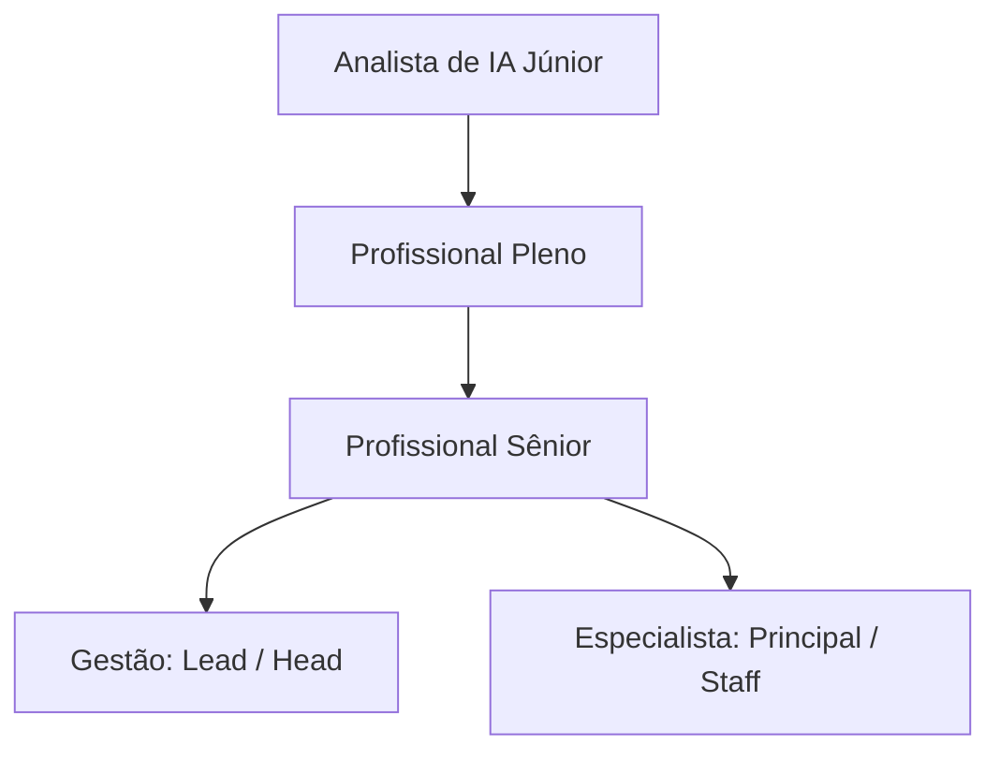

# Etapa 1 — Governança, time de IA e carreira

## Contexto e objetivos

O Bytebank fictício pretende responder dúvidas sobre políticas de contas, cartões e suporte com fundamentação documental. A direção precisa de estrutura de governança antes da codificação. A equipe é multidisciplinar e as decisões de crédito são explicitamente reservadas a pessoas autorizadas.

## Estrutura de equipe

A planilha para importar no Google Sheets está em [`data/time_ia.csv`](../data/time_ia.csv), com as colunas **Cargo**, **Responsabilidades principais**, **Nível esperado** e **Relação com o projeto de agentes IA**, além da trilha. Contém 10 funções, incluindo Engenharia de Dados, Análise de Dados, Ciência de Dados, Product Owner, Engenharia de IA e Segurança/Privacidade.

| Fase | Responsável principal (R) | Aprovação (A) | Consultados (C) | Informados (I) |
|---|---|---|---|---|
| Escopo e requisitos | Product Owner | Liderança do produto | Compliance, atendimento | Times técnicos |
| Dataset e qualidade | Engenharia de Dados | Líder de IA | Ciência de Dados, compliance | PO |
| RAG e agentes | Engenharia de IA | Líder de IA | Segurança, UX | PO |
| Avaliação e observabilidade | Análise de Dados | Líder de IA | Engenharia de IA, suporte | Diretoria |
| Aprovação de política | Compliance | Responsável pelo normativo | Segurança, operações | Equipe de IA |
| Decisões sensíveis | Analista humano autorizado | Responsável pelo processo | Compliance | Auditoria |

R = executa; A = responsável por decisão; C = consultado; I = informado. A responsabilidade final por decisões bancárias não é transferida ao modelo.

## Princípios éticos e conformidade

Este é um **projeto educacional**, com dados inteiramente sintéticos; não constitui orientação regulatória nem implementação bancária certificada. A produção exigiria validação jurídica e de segurança específica.

1. **Privacidade e LGPD:** finalidade definida; necessidade/minimização; transparência; segurança; prevenção; acesso e responsabilização. Base legal e direitos dos titulares dependem do caso concreto e devem ser analisados por profissionais autorizados.
2. **Imparcialidade:** avaliar resultados entre grupos quando houver dados legítimos e consentimentos adequados; reduzir vieses de treinamento e avaliação.
3. **Transparência e explicabilidade:** mostrar fontes, limites, encaminhamentos e distinção entre recomendação e decisão humana.
4. **Reprodutibilidade:** versionar dataset, prompts, critérios de avaliação e dependências; registrar configurações sem chaves.
5. **Responsabilidade:** trilha de decisões, acesso mínimo, revisão humana e propriedade clara dos incidentes.

## Cinco riscos de alucinação e mitigação

| Risco | Exemplo | Mitigação |
|---|---|---|
| Fonte ausente | Inventar taxa inexistente | Resposta de insuficiência de evidência e encaminhamento |
| Documento desatualizado | Regra de cartão revogada | Versão, data de vigência, rotina de revisão e expiração |
| Recuperação inadequada | Chunk de seção errada | Metadados, filtro por domínio, re-ranking e testes de recall |
| Falsa certeza | Informar aprovação de crédito | Guardrails, proibição de transação autônoma e HITL |
| Prompt injection | Documento tenta alterar regras | Separar instruções de dados, sanitizar ferramentas e testar ataques |

## Quatro pilares de LLMOps

| Pilar | Prática no Bytebank | Métrica |
|---|---|---|
| Gerenciamento | Inventário de documentos, versões, logs e proprietários | Versões auditáveis, políticas válidas |
| Otimização | Ajuste de chunking, top-k e re-ranking | Hit@4, custo, latência |
| Automação | Pipeline de carga, testes contínuos, rollback | Falhas por deploy, tempo de recuperação |
| Qualidade | Avaliação humana de fundamentação, segurança e respostas | Erros factuais, taxa de escalonamento |

## Carreira em Y

A trilha de **gestão** prioriza pessoas, estratégia, orçamento e resultados. A trilha de **especialista** aprofunda arquitetura, engenharia, pesquisa aplicada e confiabilidade. Ambas exigem comunicação, ética e visão de produto, e nenhuma é inerentemente superior.

