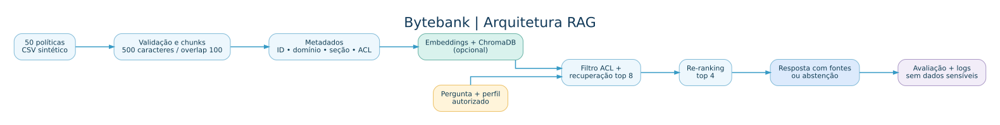
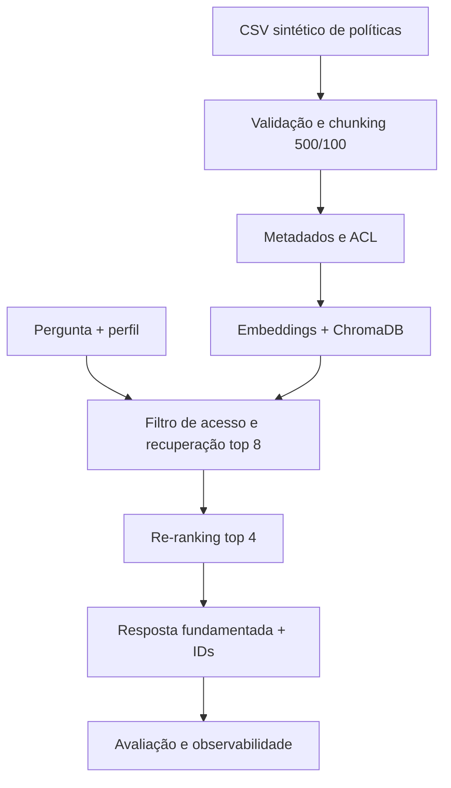

# Etapa 2 — Arquitetura RAG e glossário





## Decisões de desenho

| Elemento | Decisão | Justificativa |
|---|---|---|
| Fontes | CSV fornecido no projeto, simulado e versionado | Inspeção simples de entradas e mudanças |
| Ingestão | Validação de esquema, domínios e IDs únicos | Evitar indexar textos vazios ou inválidos |
| Chunking | `RecursiveCharacterTextSplitter`, 500 caracteres e overlap 100 | Preserva trechos de política e contexto nas bordas |
| Enriquecimento | `id`, `dominio`, `secao`, `nivel_acesso`, `categoria` | Filtro semântico + rastreabilidade por documento |
| Vetorização | OpenAI Embeddings, configurável | Conveniência e compatibilidade com Chroma |
| Banco vetorial | ChromaDB em memória | Protótipo local simples, sem depender de infraestrutura cloud |
| Recuperação | 8 candidatos e re-ranking para 4 | Amplia recall inicial sem inundar prompt |
| Resposta | Somente material recuperado, citações dos IDs | Reduz alucinação e permite revisão por humano |
| Negativa | Não responder sem evidência | Evita afirmações bancárias falsas |
| Segurança | ACL **antes** da busca e sem API key no repositório | Reduz risco de expor política restrita |

### Fontes e autorização

Os níveis `publico`, `interno` e `restrito` são **exemplos** de controle de acesso. A aplicação valida o nível do solicitante e só recupera documentos autorizados. Em produção, o perfil teria de vir de identidade autenticada e confiável, nunca de um campo editável pelo próprio usuário.

### Modo offline vs. modo vetorial

O código permite iniciar sem custo ou segredo usando similaridade lexical local. Isso serve como **teste de integração**, mas não garante equivalência com embeddings semânticos. Com `OPENAI_API_KEY` e extras, o índice usa ChromaDB + embeddings. A filtragem por `nivel_acesso` é aplicada ao mecanismo de busca vetorial, antes da geração.

### Taxonomia e exemplo de chunk

```json
{
  "page_content": "A solicitação do cartão Platinum fictício depende de análise de renda e aprovação humana expressa...",
  "metadata": {
    "id": 14,
    "dominio": "cartao_credito",
    "secao": "platinum",
    "nivel_acesso": "publico",
    "categoria": "cartoes",
    "chunk_index": 0
  }
}
```

Consulte o [glossário com mais de 15 termos e exemplos aplicados](../data/glossario.csv).

## O que falta para produção

- Avaliação de relevância por seção e multi-hop; embeddings e re-ranking calibrados com conjunto real autorizado.
- Controles de identidade, autenticação, consentimento, versionamento documental, origem/validade e DLP.
- Observabilidade sem conteúdo sensível, testes adversariais, criptografia, retenção, monitoramento e revisão regulatória.

