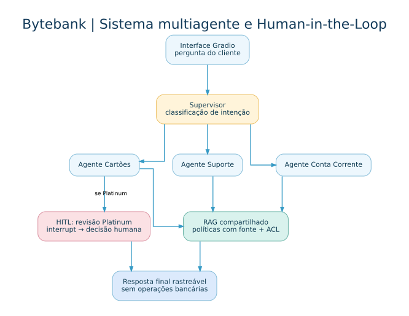
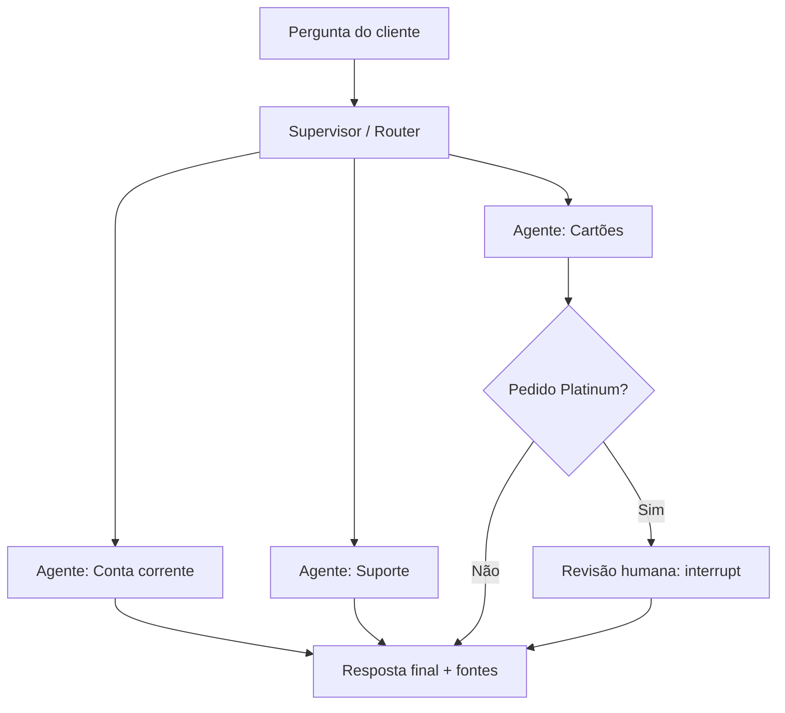

# Etapa 4 — Arquitetura multiagente e HITL





## Componentes

| Componente | Responsabilidade | Limite |
|---|---|---|
| Front-end Gradio | Receber pergunta e apresentar fontes/resposta | Não armazena credenciais bancárias |
| Supervisor | Classificar intenção e escolher exatamente um agente | Modo offline: regras; modo LLM: classificador com 3 rótulos |
| Agente de conta | Consultar políticas de contas e Pix | Sem saldo ou transferência real |
| Agente de cartões | Consultar políticas de cartão e fatura | Platinum requer revisão humana |
| Agente de suporte | Recuperar fluxos de reclamação e segurança | Não encerra ticket real |
| RAG compartilhado | Recuperar documentos autorizados, re-ranquear e citar | Não fornece documentos fora do nível de acesso |
| HITL | Registrar decisão humana antes de etapa sensível | Decisão apenas de demonstração |

## Contrato de fluxo

```text
START → supervisor → [conta_corrente | cartao_credito | suporte]
conta_corrente → resposta_final → END
suporte       → resposta_final → END
cartao_credito → [resposta_final | aprovacao_humana (interrupt)]
aprovacao_humana (Command resume) → resposta_final → END
```

No código, `build_langgraph()` monta um `StateGraph` com `InMemorySaver`. Cada sessão utiliza `thread_id`, necessário para retomar estado suspenso. `interrupt()` retorna um payload de aprovação; o humano responde e o fluxo continua via `Command(resume={"approved": ...})`.

## A2A × MCP — papéis distintos

- **A2A (Agent2Agent)**: comunicação **entre agentes** para delegação de tarefas, status, identificação de capacidades e envio de resultados.
- **MCP (Model Context Protocol)**: padronização de **ferramentas, recursos e prompts** que um agente pode acessar; ex.: `consultar_saldo` (mutação proibida no protótipo) e `consultar_fatura`.

### Ferramentas fictícias e governança

| Ferramenta MCP ilustrativa | Tipo | Tratamento obrigatório |
|---|---|---|
| `consultar_saldo` | leitura | Autenticação, autorização, minimização e log seguro |
| `consultar_fatura` | leitura | Controle de acesso por titular e política de retenção |
| `solicitar_cartao` | mutação sensível | Confirmação da pessoa, revisão humana e idempotência |
| `registrar_ticket` | mutação | Dados mínimos, protocolo, controle de duplicidade |

Essas ferramentas são **contratos documentais**, não chamadas implementadas a sistemas reais. Veja [exemplos e critérios de seleção dos protocolos](05-protocolos.md).

## Observabilidade e recuperação

Cada execução deveria registrar: identificador opaco de correlação, nome do agente, nó, duração, status, IDs de documentos recuperados, revisão humana e falha. **Nunca** registrar credenciais, CPF, dados completos de conta ou texto integral de solicitação sem base legal e política de retenção. Em produção, métricas e logs estruturados permitiriam auditoria, SLA e identificação de alucinações.

O caminho de falha seguro é: ausência de documento autorizado → mensagem de insuficiência; erro de ferramenta → tentativa controlada ou atendimento humano; timeout de aprovação → não executar ação. A aprovação nunca pode ser presumida por ausência de resposta.

